<h1 align="center">
<picture>
  <source media="(prefers-color-scheme: dark)" srcset="assets/readme/header-dark.svg">
  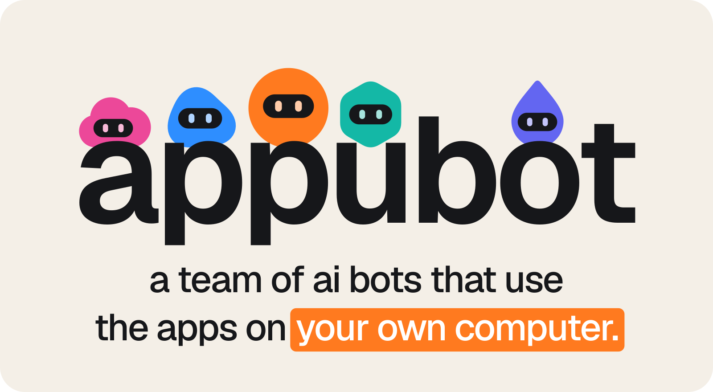
</picture>
</h1>

<div align="center">

**The open source Grok Bot alternative: a team of AI bots that use the apps on your own computer.**

<p>
A free, open source alternative to Grok Bot, OpenAI dots, Meta Muse and Cue by Manus for Mac, Windows and Linux.<br>
It runs on the Claude, ChatGPT, Cursor, Grok or Copilot account you already have,<br>
works on your own computer or around the clock in AppuBot Cloud, and answers you on Telegram.
</p>

<p>
<a href="https://github.com/sarthakguptadev/AppuBot/releases/latest/download/AppuBot-arm64.dmg"><picture><source media="(prefers-color-scheme: dark)" srcset="https://raw.githubusercontent.com/sarthakguptadev/AppuBot/readme-assets/mac-dark.png"></picture></a>
<a href="https://github.com/sarthakguptadev/AppuBot/releases/latest/download/AppuBot-Setup-x64.exe"><picture><source media="(prefers-color-scheme: dark)" srcset="https://raw.githubusercontent.com/sarthakguptadev/AppuBot/readme-assets/windows-dark.png"></picture></a>
<a href="#download"><picture><source media="(prefers-color-scheme: dark)" srcset="https://raw.githubusercontent.com/sarthakguptadev/AppuBot/readme-assets/linux-dark.png"></picture></a>
</p>
<p>
<a href="https://apps.apple.com/app/id6829390070"><picture><source media="(prefers-color-scheme: dark)" srcset="https://raw.githubusercontent.com/sarthakguptadev/AppuBot/readme-assets/appstore-dark.png"></picture></a>
<a href="https://play.google.com/store/apps/details?id=com.appubot.app"><picture><source media="(prefers-color-scheme: dark)" srcset="https://raw.githubusercontent.com/sarthakguptadev/AppuBot/readme-assets/googleplay-dark.png"></picture></a>
</p>

</div>

<picture>
  <source media="(prefers-color-scheme: dark)" srcset="assets/readme/plans-dark.svg">
  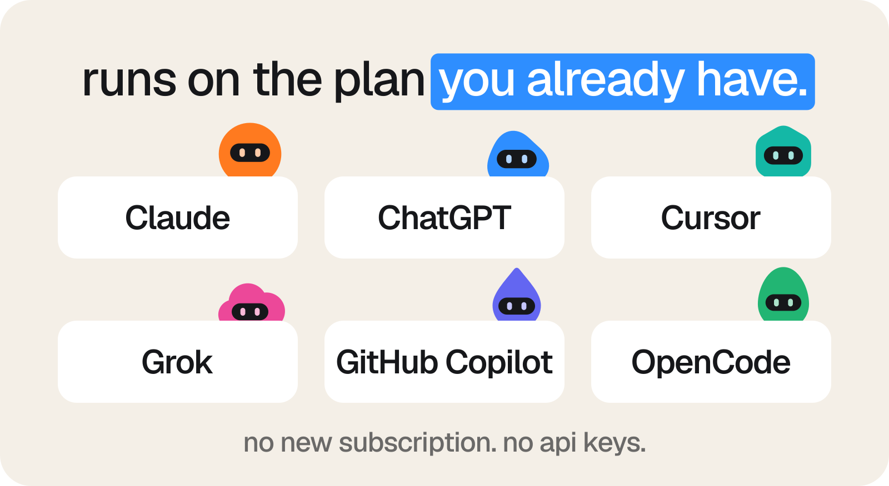
</picture>

<div align="center">

<sub>These names say what AppuBot works with, nothing more. AppuBot is an independent project, not affiliated with or endorsed by Anthropic, OpenAI, Anysphere, xAI, GitHub or Anomaly, or by the maker of any other product named on this page. Their names and trademarks belong to them.</sub>

<p>
<a href="https://github.com/sarthakguptadev/AppuBot/releases/latest"><picture><source media="(prefers-color-scheme: dark)" srcset="https://raw.githubusercontent.com/sarthakguptadev/AppuBot/readme-assets/version-dark.png"></picture></a>
<a href="https://github.com/sarthakguptadev/AppuBot/releases"><picture><source media="(prefers-color-scheme: dark)" srcset="https://raw.githubusercontent.com/sarthakguptadev/AppuBot/readme-assets/downloads-dark.png"></picture></a>
<a href="LICENSE"><picture><source media="(prefers-color-scheme: dark)" srcset="https://raw.githubusercontent.com/sarthakguptadev/AppuBot/readme-assets/license-dark.png"></picture></a>
<a href="https://x.com/AppuBot_"><picture><source media="(prefers-color-scheme: dark)" srcset="https://raw.githubusercontent.com/sarthakguptadev/AppuBot/readme-assets/x-appubot-dark.png"></picture></a>
<a href="https://x.com/sarthakguptadev"><picture><source media="(prefers-color-scheme: dark)" srcset="https://raw.githubusercontent.com/sarthakguptadev/AppuBot/readme-assets/x-sarthakguptadev-dark.png"></picture></a>
</p>

<p>
<a href="https://appubot.com">appubot.com</a> &nbsp;·&nbsp;
<a href="https://appubot.com/pricing">AppuBot Cloud</a> &nbsp;·&nbsp;
<a href="https://appubot.com/compare">Compare</a> &nbsp;·&nbsp;
<a href="https://appubot.com/compare/grok-bot">Open source Grok Bot alternative, compared</a> &nbsp;·&nbsp;
<a href="https://appubot.com/faq">FAQ</a>
</p>

<sub>Free to download · no account, no card · AppuBot Cloud from $19 a month · open source</sub>

<sub>AppuBot is an open source Grok Bot alternative: a free alternative to <b>Grok Bot</b>, <b>OpenAI dots</b>, <b>Meta Muse</b> and <b>Cue by Manus</b>, and to <b>MausBot</b>, <b>OpenBot</b>, <b>OpenClaw</b>, <b>Hermes Agent</b>, <b>Manus</b> and <b>Claude Cowork</b>: bring your own AI (Claude Code, Codex, Cursor, Grok, GitHub Copilot or OpenCode), local-first, with computer use in your real apps. An independent project, not affiliated with xAI, OpenAI, Meta or Manus.</sub>

</div>

<br>

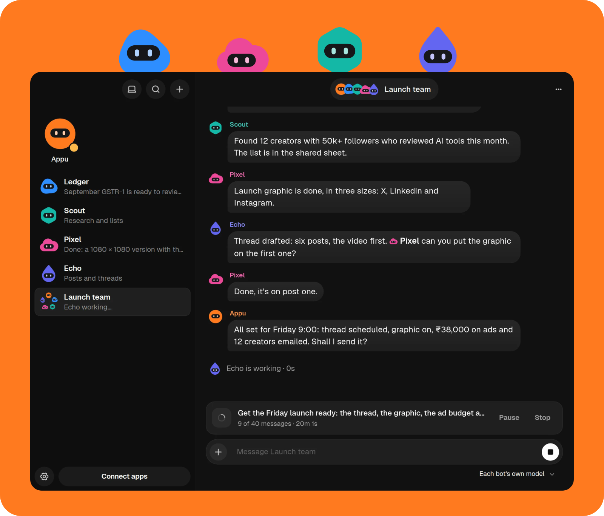
<p align="center"><sub>Five bots in one room get a launch ready: the thread, the graphic, the ad budget and the creators.</sub></p>

## Contents

- **Start here:** [Get started in 3 steps](#get-started-in-3-steps) · [Download](#download) · [What AppuBot does](#what-appubot-does)
- **See it work:** [What you can ask](#what-you-can-ask) · [A day with AppuBot](#a-day-with-appubot)
- **Learn more:** [How it works](#how-it-works) · [Your AI, your choice](#your-ai-your-choice) · [Telegram](#talk-to-your-bots-on-telegram) · [Safety and privacy](#safety-and-privacy) · [AppuBot Cloud](#appubot-cloud)
- **Decide:** [AppuBot vs Grok Bot, OpenAI dots and Meta Muse](#appubot-vs-grok-bot-openai-dots-and-meta-muse) · [Questions](#questions)
- **For developers:** [Download or build it yourself?](#download-or-build-it-yourself) · [Build from source](#build-from-source) · [Partners](#partners) · [Contributing](#contributing) · [Licence](#licence)

## Get started in 3 steps

No account, no card, no terminal and no API keys.

| Step | What to do |
| :---: | --- |
| **1** | **Download AppuBot** for your computer: [Mac (Apple silicon)](https://github.com/sarthakguptadev/AppuBot/releases/latest/download/AppuBot-arm64.dmg) · [Mac (Intel)](https://github.com/sarthakguptadev/AppuBot/releases/latest/download/AppuBot-x64.dmg) · [Windows](https://github.com/sarthakguptadev/AppuBot/releases/latest/download/AppuBot-Setup-x64.exe) · [Linux](#download). Open it like any other app. |
| **2** | **Pick your AI.** AppuBot finds the Claude Code, Codex, Copilot, Cursor, Grok or OpenCode account you're already signed in to. Not signed in yet? Sign in from the app. |
| **3** | **Say what you need.** Appu, your first bot, is ready. Type or talk: *"Rename the photos in Downloads by the date they were taken."* |

That's it. Add more bots, teach them tasks, give them routines and connect Telegram whenever you like. AppuBot keeps itself up to date.

## What AppuBot does

AppuBot gives you a team of AI bots, each with its own name, job and AI. They run on your own computer, where your files and signed-in apps already are, or on an AppuBot Cloud computer when you want them working while yours is off.

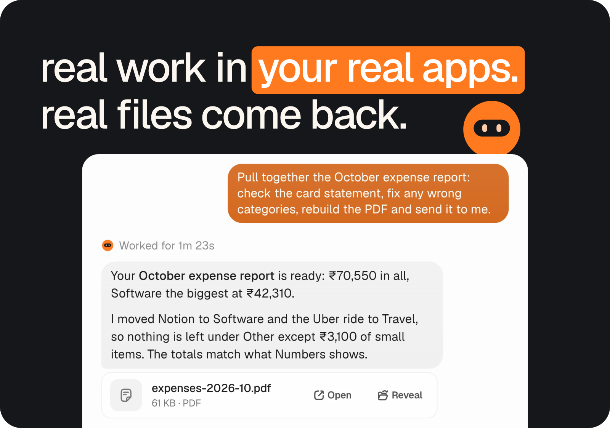

**Works in your real apps.** A bot opens an app and clicks, types and scrolls in its window: Excel, Numbers, Finder, Safari, your accounting software. Its cursor moves on your screen, so you can watch it work and take over any time. Appu rebuilds the October expense report and sends the PDF.

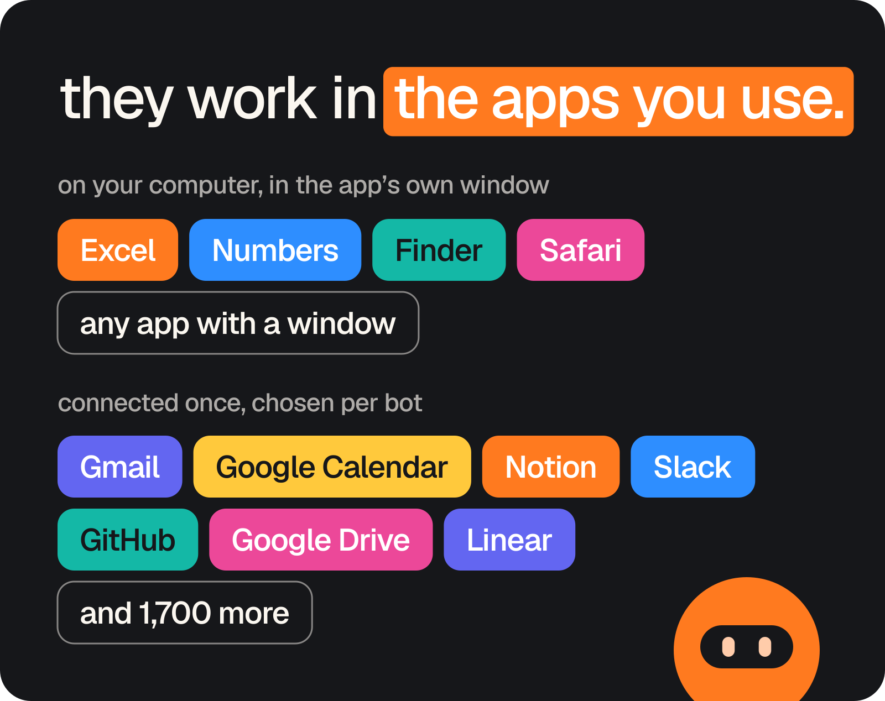

**Connected apps.** Gmail, Notion, Slack, GitHub, Google Calendar and 1,700 more, chosen per bot. Connect once, then choose which bots get each app.

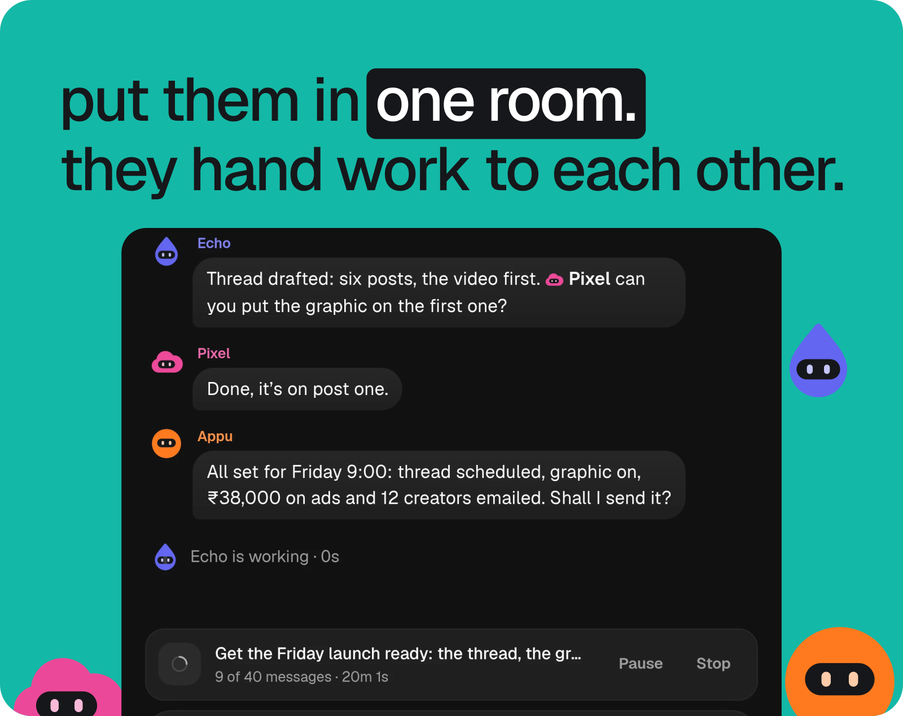

**As many bots as you like.** Each with its own job, model, memory and chats. Put several in a room and they hand work to each other. Every bot gets its own name, look, job and AI.

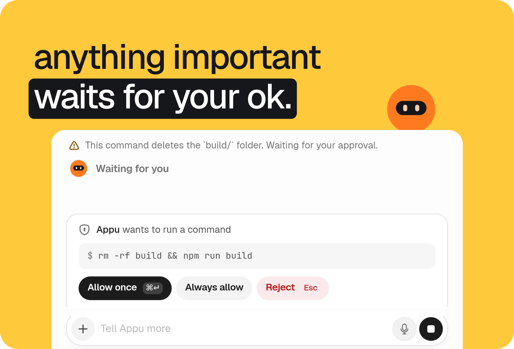

**Approvals, not surprises.** Anything important waits for your OK, however long you take. Changes, saved logins and risky commands wait for your OK.

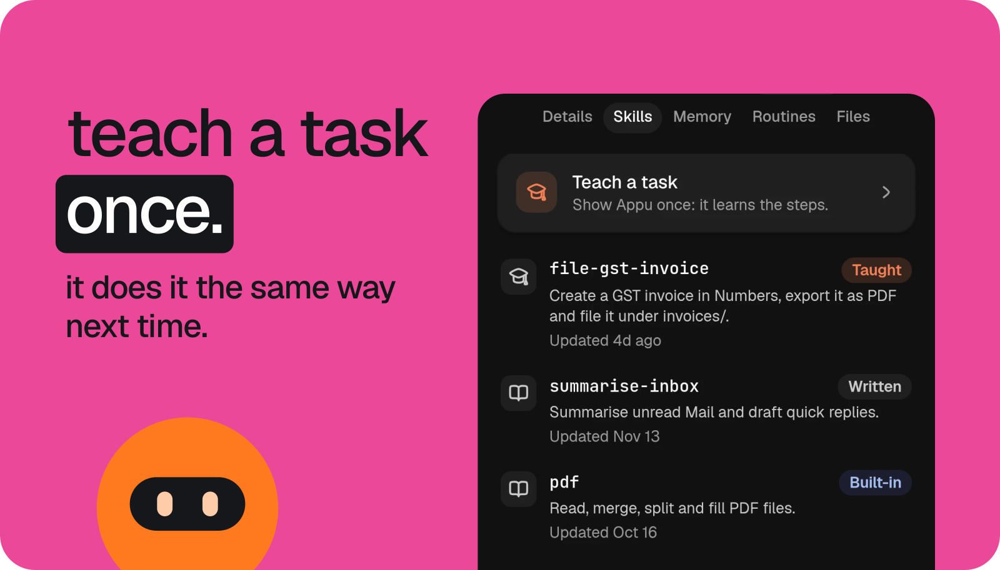

**Teach a task once.** Do it while AppuBot watches. Your bot saves it as a skill and does it the same way next time. Skills it learned by watching you, or wrote itself.

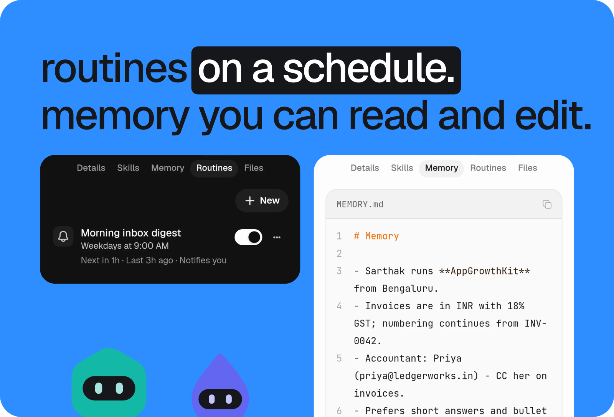

**Routines on a schedule.** Every hour, every weekday or whenever you choose. A morning inbox digest, every weekday at 9. **Memory you can read and edit.** Your rates, your accountant, how you like your replies. Plain notes you can open and change.

And the rest:

<table>
<tr><td width="30%"><b>🔑 Your own AI account</b></td><td>Each bot runs on Claude Code, Codex (ChatGPT), GitHub Copilot, Cursor, Grok or OpenCode, with the account you're already signed in to. No new subscription and no API keys.</td></tr>
<tr><td><b>💬 Message them on Telegram</b></td><td>Each bot can be a Telegram bot of its own. Text, photos, voice notes and files reach your computer; replies, questions and files come back in the chat.</td></tr>
<tr><td><b>🎙️ Talk by voice</b></td><td>Voice mode, menu bar calls, dictation and Telegram voice notes, with speech handled on your own computer.</td></tr>
<tr><td><b>📎 Files in, files out</b></td><td>PDFs, spreadsheets, photos and recordings in; invoices, exports and charts out, in the app or on Telegram.</td></tr>
<tr><td><b>💻 A terminal of its own</b></td><td>Bots can run commands, scripts and tools on your computer, with risky ones waiting for your OK.</td></tr>
<tr><td><b>📱 Phone apps</b></td><td>Message your bots and watch them work from your iPhone or Android phone.</td></tr>
<tr><td><b>☁️ AppuBot Cloud</b></td><td>Optional: your bots on a cloud computer of their own, with a live desktop you can watch or take over, so routines and Telegram keep going while your laptop is off. From $19 a month.</td></tr>
</table>

## What you can ask

Talk to a bot the way you'd talk to a colleague. A few things people hand over:

<details open>
<summary><b>💰 Money and paperwork</b></summary>


| You say | Your bot |
| --- | --- |
| *"Make the October expense report from the receipts in my Downloads folder."* | Reads each receipt, fills your expense sheet in Numbers or Excel, and sends you the PDF. |
| *"Send invoices to every client I worked for this month."* | Fills your invoice template with your rates from memory, saves the PDFs and drafts the emails for your OK. |
| *"Download this quarter's bank statements and put them in the Tax folder."* | Signs in with your saved login, after asking you, downloads each statement and files it by month. |
| *"Which subscriptions did I pay for last month?"* | Goes through your statements or email receipts and gives you a list with totals. |


</details>

<details>
<summary><b>📧 Email, calendar and messages</b></summary>


| You say | Your bot |
| --- | --- |
| *"Every weekday at 9, tell me what came in overnight that needs me."* | Runs a routine that reads your inbox and sends a short digest to the app or Telegram. |
| *"Reply to the three people asking for a meeting and offer Tuesday afternoon."* | Checks your calendar, drafts each reply and waits for your OK before sending. |
| *"Find the contract Priya sent in March and send it to my accountant."* | Searches your email, finds the attachment and sends it to the address it remembers. |


</details>

<details>
<summary><b>🔍 Research</b></summary>


| You say | Your bot |
| --- | --- |
| *"Compare the five cheapest flights to Goa next Friday."* | Searches in your browser and gives you a table with times, prices and links. |
| *"Find 20 cafés in Bangalore that might stock our coffee, with their Instagram."* | Searches the web and saves a spreadsheet you can open. |
| *"Read these 12 PDFs and tell me what they say about refunds."* | Reads each file and answers with quotes and page numbers. |


</details>

<details>
<summary><b>📣 Sales and marketing</b></summary>


| You say | Your bot |
| --- | --- |
| *"Write this week's launch thread and make the graphic."* | Drafts the posts, makes the image and puts both in the chat for you to post. |
| *"Add everyone who signed up today to the CRM."* | Opens your CRM in its own window and types each one in. |
| *"Each Monday, tell me how last week's ads did."* | Runs a routine that reads your ad dashboards and sends you the numbers. |


</details>

<details>
<summary><b>🗂️ Files and your computer</b></summary>


| You say | Your bot |
| --- | --- |
| *"Rename the photos in Downloads by the date they were taken."* | Renames every file and tells you what changed. |
| *"Turn this voice note into a to-do list."* | Listens to the recording and writes the list. |
| *"Clean up my Desktop: put files into folders by type."* | Moves the files into folders and shows you where everything went. |


</details>

<details>
<summary><b>👩‍💻 For developers</b></summary>


| You say | Your bot |
| --- | --- |
| *"Fix the failing test and open a pull request."* | Runs your tests in its terminal, makes the fix and opens the pull request with your GitHub account. |
| *"Every night, update the dependencies and tell me if anything breaks."* | Runs a routine and reports in the morning. |
| *"Check the staging site in Safari and send me screenshots of anything broken."* | Clicks through the site in a real browser and sends what it finds. |

</details>

<sub>Examples of what people ask. What a bot can do depends on the AI it uses, the apps you've connected and what you allow.</sub>

## A day with AppuBot

| When | What happens |
| --- | --- |
| **9:00** | Appu's morning routine sends your inbox digest to Telegram while you're still at breakfast. |
| **10:30** | On the bus, you send Ledger a photo of a receipt. It adds it to this month's expenses on your computer at home. |
| **12:00** | Scout finishes the competitor research you asked for and drops the spreadsheet in the chat. |
| **15:00** | Pixel wants to post the launch graphic. You get an approval on your phone and tap Allow. |
| **18:00** | Your laptop is closed. With AppuBot Cloud, Echo keeps answering on Telegram and the evening routine still runs. |

## Download

Always the newest version, straight from the [latest release](https://github.com/sarthakguptadev/AppuBot/releases/latest):

| Computer | Download | Then |
| --- | --- | --- |
| Mac with Apple silicon (M1 and later) | [AppuBot-arm64.dmg](https://github.com/sarthakguptadev/AppuBot/releases/latest/download/AppuBot-arm64.dmg) | Open it and drag AppuBot to Applications |
| Mac with an Intel processor | [AppuBot-x64.dmg](https://github.com/sarthakguptadev/AppuBot/releases/latest/download/AppuBot-x64.dmg) | Open it and drag AppuBot to Applications |
| Windows (most PCs) | [AppuBot-Setup-x64.exe](https://github.com/sarthakguptadev/AppuBot/releases/latest/download/AppuBot-Setup-x64.exe) | Run it and follow the installer |
| Windows on Arm | [AppuBot-Setup-arm64.exe](https://github.com/sarthakguptadev/AppuBot/releases/latest/download/AppuBot-Setup-arm64.exe) | Run it and follow the installer |
| Linux, any distribution (x64 / Arm) | [AppuBot-x86_64.AppImage](https://github.com/sarthakguptadev/AppuBot/releases/latest/download/AppuBot-x86_64.AppImage) · [AppuBot-arm64.AppImage](https://github.com/sarthakguptadev/AppuBot/releases/latest/download/AppuBot-arm64.AppImage) | `chmod +x` the file, then open it |
| Debian / Ubuntu (x64 / Arm) | [appubot_amd64.deb](https://github.com/sarthakguptadev/AppuBot/releases/latest/download/appubot_amd64.deb) · [appubot_arm64.deb](https://github.com/sarthakguptadev/AppuBot/releases/latest/download/appubot_arm64.deb) | `sudo apt install ./appubot_amd64.deb` |

Not sure which Mac you have? Apple menu › About This Mac: "Chip: Apple M…" means Apple silicon.

| On your phone | AppuBot Cloud |
| --- | --- |
| Message your bots and watch them work from anywhere: [App Store](https://apps.apple.com/app/id6829390070) · [Google Play](https://play.google.com/store/apps/details?id=com.appubot.app) | Your bots on a cloud computer of their own, so they keep working while your laptop is closed or off. Optional and paid: [plans and prices](https://appubot.com/pricing) |

AppuBot updates itself. It looks for new versions in the background, downloads them, and installs them the next time it restarts. You can also check from **Settings › About**.

**On a Mac**, the first time a bot uses your apps, macOS asks you to allow AppuBot in **Privacy & Security**: Accessibility (to click and type), Screen Recording (to see the window it works in) and, for voice, the Microphone. AppuBot shows you where each switch is.

## How it works


1. **You ask** in the app, from your phone, by voice or on Telegram.
2. **Your bot** adds what it knows: its job, its memory about you and the skills you taught it.
3. **Your AI does the thinking.** AppuBot runs the agent you chose (it speaks the open Agent Client Protocol) with the account you're already signed in to. AppuBot never routes your chats through servers of its own.
4. **Tools do the work:** clicking and typing in an app's window, a terminal, files on your computer, and the apps you connected.
5. **You stay in charge.** Important steps wait for your OK, you can watch every click live, and you can stop a bot at any time.

## Your AI, your choice

Each bot can use a different AI. Use the plans you already pay for, and switch a bot from one to another any time.

| AI | Uses |
| --- | --- |
| **Claude Code** | Your Claude account (Anthropic) |
| **Codex** | Your ChatGPT account (OpenAI) |
| **GitHub Copilot** | Your GitHub Copilot account |
| **Cursor** | Your Cursor account |
| **Grok** | Your Grok account (xAI) |
| **OpenCode** | The models you set up in OpenCode |
| **AppuBot AI** | On AppuBot Cloud plans: a Claude allowance included as a limited-time launch offer, with nothing to sign in to |

You can add more than one account of the same AI, say a work and a personal Claude, and choose which bot uses which.

## Talk to your bots on Telegram


1. On Telegram, make a bot with [@BotFather](https://t.me/BotFather) and copy its token.
2. In AppuBot, open **Settings › Channels**, paste the token and choose which of your bots it is.
3. Message it. Approve your Telegram account with the code shown on your computer, once.

Now text, photos, voice notes and files reach that bot on your computer, and its replies, questions and files come back in the same chat. Only the Telegram accounts you approve can talk to it. Give each bot its own Telegram handle if you like.

## Safety and privacy

- **Approvals.** Anything important, like sending, paying, using a saved login or running a risky command, waits for your OK, however long you take.
- **Watch and take over.** A bot's cursor moves on your screen in the window it's working in. Stop it any time.
- **Your data stays with you.** Your bots, their files and everything they see stay on your computer. What leaves is what a bot sends to its AI provider, as when you use that AI yourself.
- **No AppuBot account, no servers in the middle.** The app's gateway listens only on your own computer (127.0.0.1).
- **Anonymous usage counts only:** which features get used, never your messages, files or names. Builds you make from this code send none.
- **Saved logins are locked away** in the app's vault, and a bot asks before it uses one.
- **Code you can read.** Everything the app does is in this repository.

Found a security problem? See [SECURITY.md](SECURITY.md).

## AppuBot Cloud

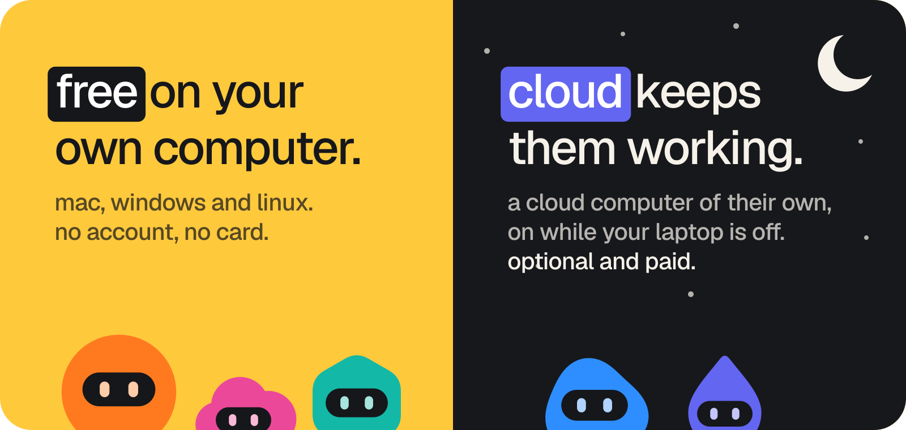

The app is free on your own computer, and stays that way. AppuBot Cloud is the optional extra: a cloud computer of their own for your bots, with a live desktop you can watch or take over, so they keep working while your laptop is off. It works from the desktop app or from just your phone.

| Plan | Price | Computer |
| --- | --- | --- |
| **Free** | $0 | Your own Mac, Windows or Linux computer |
| **Starter** | $19 a month | 2 vCPU, 4 GB memory, 12 GB storage |
| **Pro** | $49 a month | 4 vCPU, 8 GB memory, 20 GB storage |
| **Max** | $79 a month | 4 vCPU, 16 GB memory, 40 GB storage |
| **Ultra** | $109 a month | 4 vCPU, 32 GB memory, 80 GB storage |

**Work plans** give a team one shared cloud computer, with shared bots, routines and apps: Team, Business and Scale, from $69 a month. Every plan has unlimited bots and no hour limits, starts with a 3-day trial for $1, and yearly billing gives two months free. Prices in US dollars, before tax. See [appubot.com/pricing](https://appubot.com/pricing).

## AppuBot vs Grok Bot, OpenAI dots and Meta Muse

Grok Bot (xAI), dots (OpenAI) and Muse (Meta) work on a computer in the cloud. AppuBot works on yours.

| | AppuBot | Grok Bot | OpenAI dots | Meta Muse |
| --- | --- | --- | --- | --- |
| Price | Free on your computer; Cloud from $19 a month | $30 to $200 a month, plus extra usage | ChatGPT Pro, $100 to $500 a month, or Business Premium | Free up to a limit, then $20 or $100 a month |
| Uses the apps on your computer | Yes, any app, in its own window | No, it works on its own cloud computer | Partly: a connected computer gives it your files and browser | No, it works in a cloud browser |
| AI model | Your choice: Claude Code, Codex, Copilot, Cursor, Grok or OpenCode | Grok only | GPT-6 Astra only | Muse Spark only |
| How many agents | As many bots as you like | Many bots, sharing one cloud computer | One dot to start | One Muse per person |
| Where you talk to it | The desktop app and Telegram | Desktop app and iOS | ChatGPT, Slack, Teams and calls | Muse app, muse.ai and WhatsApp |

<sub>From the makers' own pages, as of 17 October 2026. Sources and the full comparison: <a href="https://appubot.com/compare">appubot.com/compare</a>.</sub>

**Looking at MausBot, OpenBot, OpenClaw, Hermes Agent, Manus or Claude Cowork?** AppuBot is one app you install and use straight away:

- Nothing to host or set up: no server, no Docker, no API keys.
- Its bots use any app on your Mac or PC, clicking and typing in its own window, while you watch their cursor.
- It runs the AI you already pay for, a different one per bot if you like.
- Each bot can answer you on Telegram, from anywhere.

## Questions

<details>
<summary><b>Is AppuBot free?</b></summary>
<br>
Yes. The app is free on your own computer, with no account and no card, and it stays that way. If you want your bots to keep working while your computer is off, AppuBot Cloud is an optional add-on from $19 a month, with Work plans for teams from $69 a month, and every plan starts with a 3-day trial for $1. Either way, you keep paying only your own AI plan, like Claude or ChatGPT.
</details>

<details>
<summary><b>Is AppuBot a Grok Bot alternative?</b></summary>
<br>
Yes. Like Grok Bot, it gives you a team of named AI bots you message like colleagues. Unlike it, they run on your own computer, use the apps on it, and can use Claude, ChatGPT (Codex), Copilot, Cursor, OpenCode or Grok.
</details>

<details>
<summary><b>Does AppuBot run on Windows and Linux?</b></summary>
<br>
Yes. It's made for the Mac first, with Windows and Linux versions too, computer use included.
</details>

<details>
<summary><b>Where does my data go?</b></summary>
<br>
It stays on your computer. What leaves is what a bot sends to its AI provider, such as Anthropic or OpenAI, just like when you use that AI yourself, and anonymous usage counts: which features get used, never your messages, files or names. Builds you make from this code send none.
</details>

<details>
<summary><b>Is AppuBot open source?</b></summary>
<br>
Yes. Its code is public here under the Apache License 2.0: you may read it, build it, change it and use it in your own work, paid work included. The AppuBot name and logo are not part of that, and one folder of components keeps its own licence. See <a href="#licence">Licence</a>.
</details>

<details>
<summary><b>Do I need an API key or a new AI subscription?</b></summary>
<br>
No. Your bots use the Claude, ChatGPT (Codex), Cursor, Grok, GitHub Copilot or OpenCode account you're already signed in to. AppuBot never asks for an API key.
</details>

<details>
<summary><b>What is computer use?</b></summary>
<br>
Your bot uses the apps on your computer the way you do: it looks at a window, then clicks, types and scrolls in it, so it can finish work in real apps like Numbers, Safari or your accounting software. It works inside the app's own window and mostly leaves your mouse alone.
</details>

<details>
<summary><b>Is it safe to give a bot access to my computer?</b></summary>
<br>
Your bot asks before it does anything important and waits for your answer however long you take. You can watch it work live and stop it at any time, and only the Telegram accounts you approve can message it. See <a href="#safety-and-privacy">Safety and privacy</a>.
</details>

<details>
<summary><b>Can I teach it something only I know how to do?</b></summary>
<br>
Yes. Press "Teach a task" and do it once while AppuBot watches. Your bot turns it into a skill and does it the same way next time. You can read and change its skills, instructions and memory at any time.
</details>

<details>
<summary><b>Can I use it with just my phone?</b></summary>
<br>
Yes, with AppuBot Cloud: buy a plan on the website, sign in on the phone app, and your bots live on your cloud computer. You never need a Mac or PC.
</details>

<details>
<summary><b>Can I cancel AppuBot Cloud?</b></summary>
<br>
Any time, on account.appubot.com. Your plan runs to the end of the period you paid for. Cancel during the trial and you pay only its $1, and you can ask for a full refund within 14 days of your first payment.
</details>

<details>
<summary><b>Is it AppuBot or Appu Bot?</b></summary>
<br>
AppuBot, one word, but Appu Bot is the same app: the one at appubot.com, made by Sarthak Gupta. Appu is also the name of the first bot you get.
</details>

More answers in the <a href="https://appubot.com/faq">FAQ</a>.

## Download or build it yourself?

**Download it.** Building AppuBot yourself is for people who want to work on its code. It takes a full developer setup, and what you get is a development build without the things that make the download easy to live with:

| | Download | Build it yourself |
| --- | :---: | :---: |
| Time to your first bot | A few minutes | Much longer: toolchains, installs, builds |
| Tools you need | None | Git, Node 22+, pnpm 11, and on a Mac the Xcode tools and Swift |
| Signed and notarized | ✅ | ❌ macOS and Windows warn you about an unknown developer |
| Updates itself | ✅ | ❌ pull, reinstall and rebuild for every release |
| Mac permissions | Granted once | May need granting again after a rebuild |
| Apps directory | Refreshed every release | The copy in the source |
| Installers for Mac, Windows and Linux | ✅ all six | Only what you package and sign yourself |
| Help from us | ✅ | Best effort |

[Download AppuBot](#download) and you're done. Still want to build it? Read on.

## Build from source

<details>
<summary><b>Show the full build steps</b></summary>

### 1. Install the toolchain

| | Mac | Windows | Linux |
| --- | --- | --- | --- |
| Git | ✅ | ✅ | ✅ |
| Node.js 22 or later | ✅ | ✅ | ✅ |
| pnpm 11 (`corepack enable`) | ✅ | ✅ | ✅ |
| Xcode Command Line Tools and Swift (`xcode-select --install`) | ✅ | | |
| Bash (Git Bash or WSL) for the scripts | | ✅ | |
| `ruby`, `build-essential` and `fpm` to package a `.deb` on Arm | | | ✅ |

### 2. Get the code and its dependencies

```bash
git clone https://github.com/sarthakguptadev/AppuBot.git
cd AppuBot
pnpm install
```

### 3. Build the parts the app needs before it can start

```bash
pnpm -C packages/mcp-bridge build                   # the tools bridge the bots use

# Mac only: the Swift helper for screenshots, input and notifications
cd native/appubot-helper
swift build -c release
codesign --force --sign - .build/release/appubot-helper .build/release/appubot-notify
cd ../..
```

### 4. Run it

```bash
pnpm dev:desktop
```

On a Mac, a development build runs as Electron, so macOS asks again for Accessibility, Screen Recording and the Microphone, and the switches you need are under Electron or your terminal app rather than AppuBot.

### 5. Check your changes

```bash
pnpm typecheck && pnpm test
pnpm check                                          # Mac: everything, with a build and a launch test
```

### 6. Package an installer (optional)

```bash
pnpm -C apps/desktop dist                           # Mac: an unpacked .app
pnpm -C apps/desktop dist:win                       # Windows: an NSIS installer
pnpm -C apps/desktop dist:linux                     # Linux: an AppImage and a .deb
```

These come out unsigned. To sign and notarize a Mac build you need an Apple Developer ID certificate (`CSC_LINK`, `CSC_KEY_PASSWORD`) and an App Store Connect API key (`APPLE_API_KEY`, `APPLE_API_KEY_ID`, `APPLE_API_ISSUER`); see [release.yml](.github/workflows/release.yml) for how our releases do it. Your installers won't update themselves from our releases.

A build of your own signs in, pairs phones and connects apps through AppuBot's services, like ours. It sends no usage analytics.

### What's where

| Folder | What's in it |
| --- | --- |
| `apps/desktop` | The app: Electron, with the gateway and services in `src/main` and the React UI in `src/renderer` |
| `packages/protocol` | The shapes of everything the app's parts send each other |
| `packages/client` | The typed client for the app's gateway |
| `packages/chat-core` | Chat logic shared by the UI and the gateway |
| `packages/agent-runtime` | Runs the AI agents (Claude Code, Codex, Copilot, Cursor, Grok, OpenCode) over the Agent Client Protocol |
| `packages/mcp-bridge` | The tools a bot uses: computer use, files, questions |
| `packages/theme` | Colours, type and shapes |
| `native/appubot-helper` | The Mac's Swift helper: screenshots, input, notifications |
| `scripts` | Dev, test, release and benchmark scripts |

</details>

## Partners

The companies that build and back AppuBot.

<p>
<a href="https://www.agent37.com/?ref=appubot"><picture><source media="(prefers-color-scheme: dark)" srcset="assets/readme/partners/agent37-dark.png"></picture></a>
<a href="https://loops.so/?ref=appubot"><picture><source media="(prefers-color-scheme: dark)" srcset="assets/readme/partners/loops-dark.png"></picture></a>
<a href="https://www.rareui.com/?ref=appubot"><picture><source media="(prefers-color-scheme: dark)" srcset="assets/readme/partners/rareui-dark.png"></picture></a>
</p>

| Partner | What it does for AppuBot |
| --- | --- |
| [Agent 37](https://www.agent37.com/?ref=appubot) | Hosts AppuBot Cloud: every plan's cloud computer, with its live desktop and nightly backups. |
| [Loops](https://loops.so/?ref=appubot) | Sponsors AppuBot: the email platform for software companies. |
| [Rare UI](https://www.rareui.com/?ref=appubot) | Animated React components used in the app, by Swami Malode. |

**Want your product here?** AI models, cloud computers, tools and the services apps are built on: partners and sponsors get a post on X, a badge here and on [appubot.com/partners](https://appubot.com/partners), a link to their site, a place in our ads, and the views and traffic that come with them. [✉️ Become a partner](mailto:sarthak@appubot.com?subject=Partnering%20with%20AppuBot).

## Contributing

Found a bug or have an idea? [Open an issue](https://github.com/sarthakguptadev/AppuBot/issues/new/choose) or start a [discussion](https://github.com/sarthakguptadev/AppuBot/discussions). Pull requests are welcome: start with [CONTRIBUTING.md](CONTRIBUTING.md) and the [code of conduct](CODE_OF_CONDUCT.md).

By sending a contribution you agree to our [Contributor Licence Agreement](CLA.md). In short: you keep the copyright in your work, and you give us a licence to use it in AppuBot, including in paid versions.

The phone apps, AppuBot Cloud and AppuBot's servers are run by us. If something's wrong with them, tell us in an issue. Security problems go to [SECURITY.md](SECURITY.md).

## Licence

AppuBot is open source under the [Apache License 2.0](LICENSE). You may use, change and share the code for any purpose, in your own products too, as long as you pass on the licence and keep the notices in [NOTICE](NOTICE).

Copyright 2026 Sarthak Gupta. The licence does not cover these things:

- The AppuBot name, logo, app icon and robot face are not licensed. All rights reserved: see [TRADEMARKS.md](TRADEMARKS.md).
- The AppuBot Cloud picture (`apps/desktop/src/renderer/src/assets/cloud-promo.webp`) is not licensed. All rights reserved.
- `apps/desktop/src/renderer/src/components/rare` is Rare UI by Swami Malode, under its own licence in that folder, not the Apache License. It may not be sold, or given out apart from an application.
- Other third-party code keeps its own licence, and other companies' names and logos belong to their owners: see [THIRD_PARTY_NOTICES.md](THIRD_PARTY_NOTICES.md).

Every version of AppuBot, from the first release on, is available under the Apache License 2.0, whatever licence came with it. The same exceptions apply to every version.

<br>

<p align="center">
<br>
<sub>Made by Sarthak Gupta (<a href="https://x.com/sarthakguptadev">@sarthakguptadev</a>)<br><a href="https://appubot.com">appubot.com</a> · <a href="https://x.com/AppuBot_">@AppuBot_</a> · <a href="mailto:sarthak@appubot.com">sarthak@appubot.com</a></sub>
</p>
