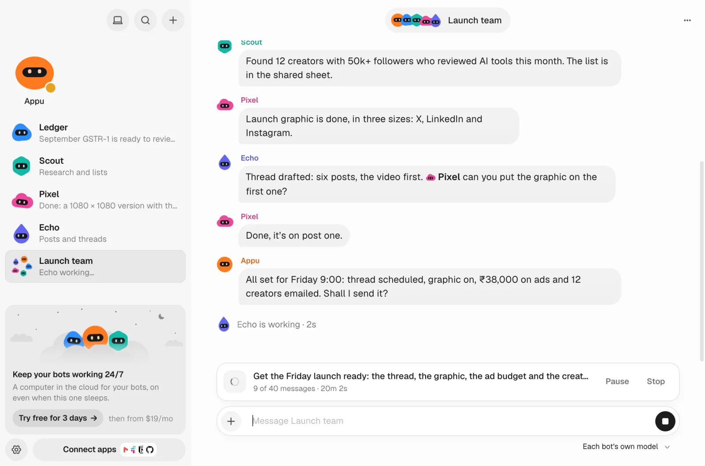
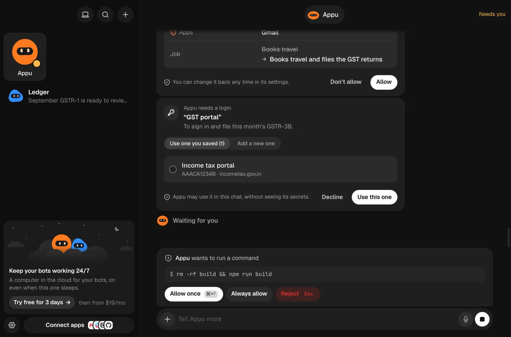
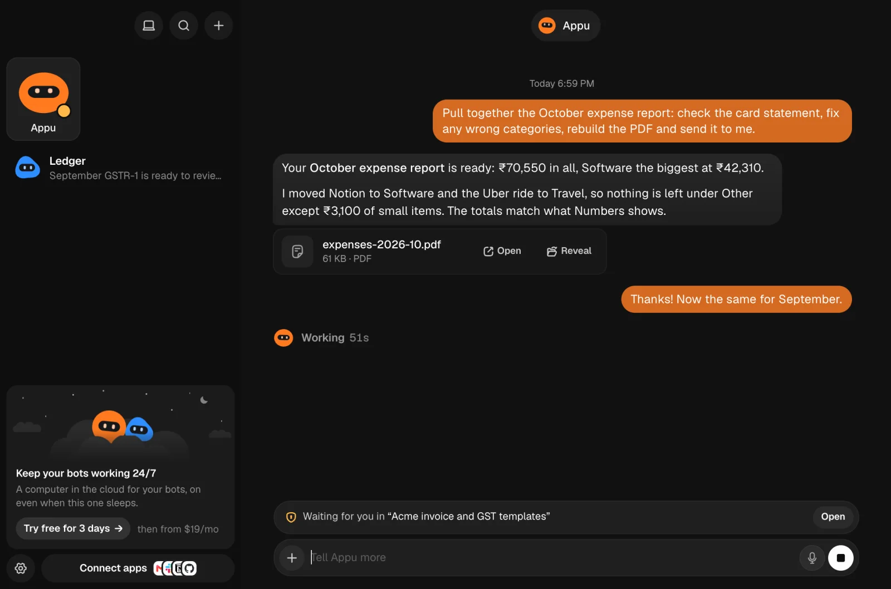
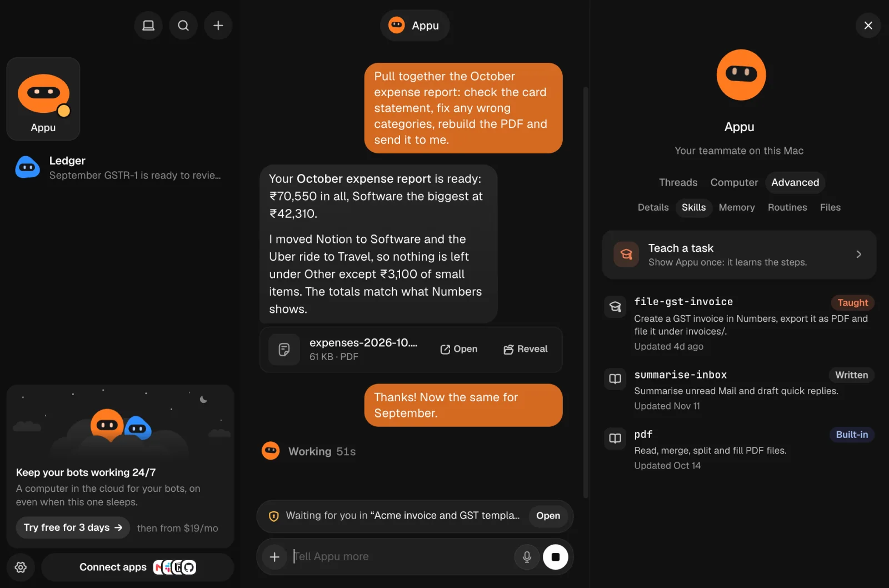
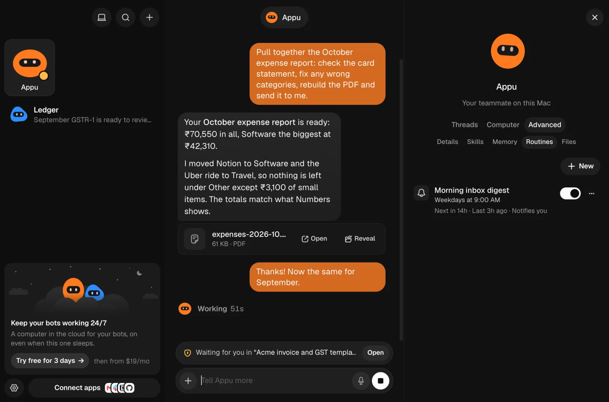
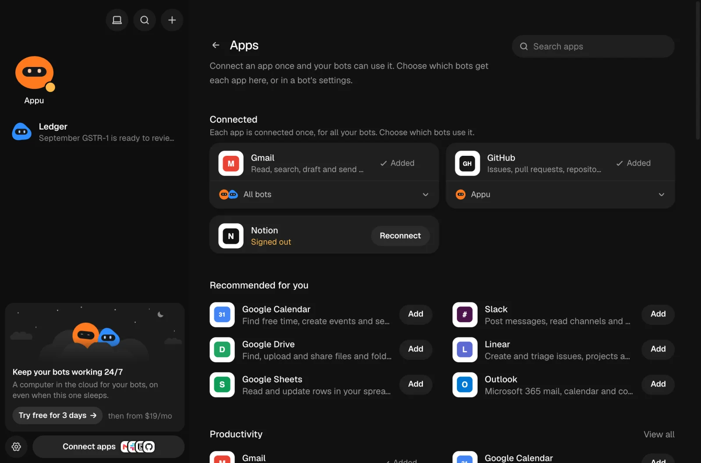
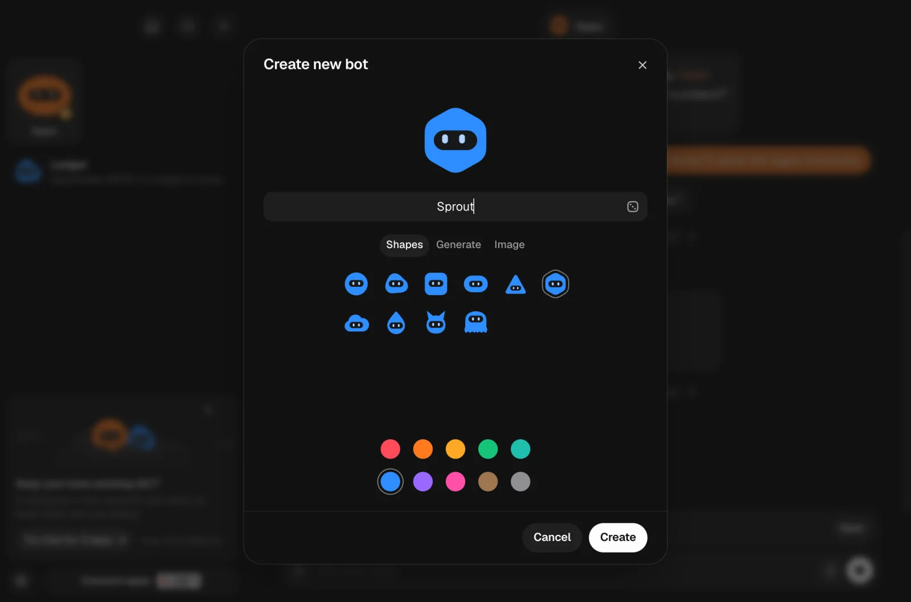

<picture>
  <source media="(prefers-color-scheme: dark)" srcset="assets/readme/bots-dark.webp">
  
</picture>

<div align="center">

# AppuBot

**The free Grok Bot alternative: a team of AI bots that use the apps on your own computer.**

<p>
A free alternative to Grok Bot, OpenAI dots and Meta Muse for Mac, Windows and Linux.<br>
It runs on the Claude, ChatGPT, Cursor, Grok or Copilot account you already have,<br>
works on your own computer or around the clock in AppuBot Cloud, and answers you on Telegram.
</p>

<p>
<a href="https://github.com/sarthakguptadev/AppuBot/releases/latest/download/AppuBot-arm64.dmg"><picture><source media="(prefers-color-scheme: dark)" srcset="assets/readme/buttons/mac-dark.png"></picture></a>
<a href="https://github.com/sarthakguptadev/AppuBot/releases/latest/download/AppuBot-Setup-x64.exe"><picture><source media="(prefers-color-scheme: dark)" srcset="assets/readme/buttons/windows-dark.png"></picture></a>
<a href="#download"><picture><source media="(prefers-color-scheme: dark)" srcset="assets/readme/buttons/linux-dark.png"></picture></a>
<a href="https://apps.apple.com/app/id6829390070"><picture><source media="(prefers-color-scheme: dark)" srcset="assets/readme/buttons/appstore-dark.png"></picture></a>
<a href="https://play.google.com/store/apps/details?id=com.appubot.app"><picture><source media="(prefers-color-scheme: dark)" srcset="assets/readme/buttons/googleplay-dark.png"></picture></a>
</p>

<p>
<a href="https://github.com/sarthakguptadev/AppuBot/releases/latest"></a>
<a href="https://github.com/sarthakguptadev/AppuBot/releases"></a>
<a href="https://github.com/sarthakguptadev/AppuBot/actions/workflows/ci.yml"></a>
<a href="LICENSE.md"></a>
<a href="https://x.com/AppuBot_"></a>
</p>

<p>
<a href="https://appubot.com">appubot.com</a> &nbsp;·&nbsp;
<a href="https://appubot.com/pricing">AppuBot Cloud</a> &nbsp;·&nbsp;
<a href="https://appubot.com/compare">Compare</a> &nbsp;·&nbsp;
<a href="https://appubot.com/faq">FAQ</a>
</p>

<sub>Free to download · no account, no card · AppuBot Cloud from $19 a month · source available</sub>

<sub>AppuBot is a free alternative to <b>Grok Bot</b>, <b>OpenAI dots</b> and <b>Meta Muse</b>, and to <b>MausBot</b>, <b>OpenBot</b>, <b>OpenClaw</b>, <b>Hermes Agent</b>, <b>Manus</b> and <b>Claude Cowork</b>: bring your own AI (Claude Code, Codex, Cursor, Grok, GitHub Copilot or OpenCode), local-first, with computer use in your real apps.</sub>

</div>

<br>

<picture>
  <source media="(prefers-color-scheme: dark)" srcset="assets/readme/app-dark.webp">
  
</picture>
<p align="center"><sub>Five bots in one room get a launch ready: the thread, the graphic, the ad budget and the creators.</sub></p>

## Contents

- [What AppuBot does](#what-appubot-does) · [A look around](#a-look-around) · [Download](#download)
- [AppuBot vs Grok Bot, OpenAI dots and Meta Muse](#appubot-vs-grok-bot-openai-dots-and-meta-muse) · [Questions](#questions)
- [Build from source](#build-from-source) · [Contributing](#contributing) · [Licence](#licence)

## What AppuBot does

AppuBot gives you a team of AI bots, each with its own name, job and AI. They run on your own computer, where your files and signed-in apps already are, or on an AppuBot Cloud computer when you want them working while yours is off.

| | |
| --- | --- |
| **Works in your real apps** | A bot opens an app and clicks, types and scrolls in its window: Excel, Numbers, Finder, Safari, your accounting software. Its cursor moves on your screen, so you can watch it work and take over any time. |
| **Your own AI account** | Each bot runs on Claude Code, Codex (ChatGPT), GitHub Copilot, Cursor, Grok or OpenCode, with the account you're already signed in to. No new subscription and no API keys. |
| **As many bots as you like** | Each with its own job, model, memory and chats. Put several in a room and they hand work to each other. |
| **Message them on Telegram** | Each bot can be a Telegram bot of its own. Text, photos, voice notes and files reach your computer; replies, questions and files come back in the chat. |
| **Teach a task once** | Do it while AppuBot watches. Your bot saves it as a skill and does it the same way next time. |
| **Routines on a schedule** | Every hour, every weekday or whenever you choose. |
| **Memory you can read and edit** | Your rates, your accountant, how you like your replies. |
| **Approvals, not surprises** | Anything important waits for your OK, however long you take. |
| **Connected apps** | Gmail, Notion, Slack and 1,700 more, chosen per bot. |
| **Talk by voice** | Voice mode, menu bar calls, dictation and Telegram voice notes, with speech handled on your own computer. |
| **Files in, files out** | PDFs, spreadsheets, photos and recordings in; invoices, exports and charts out, in the app or on Telegram. |
| **AppuBot Cloud** | Optional: your bots on a cloud computer of their own, with a live desktop you can watch or take over, so routines and Telegram keep going while your laptop is off. From $19 a month. |

## A look around

<table>
<tr>
<td width="50%"></td>
<td width="50%"></td>
</tr>
<tr>
<td><sub><b>Approvals, not surprises.</b> Changes, saved logins and risky commands wait for your OK.</sub></td>
<td><sub><b>Real work, real files.</b> Appu rebuilds the October expense report and sends the PDF.</sub></td>
</tr>
<tr>
<td></td>
<td></td>
</tr>
<tr>
<td><sub><b>Teach a task once.</b> Skills it learned by watching you, or wrote itself.</sub></td>
<td><sub><b>Routines.</b> A morning inbox digest, every weekday at 9.</sub></td>
</tr>
<tr>
<td></td>
<td></td>
</tr>
<tr>
<td><sub><b>Connected apps.</b> Connect once, then choose which bots get each app.</sub></td>
<td><sub><b>A team of your own.</b> Every bot gets its own name, look, job and AI.</sub></td>
</tr>
</table>

## Download

Always the newest version, straight from the [latest release](https://github.com/sarthakguptadev/AppuBot/releases/latest):

| Computer | Download |
| --- | --- |
| Mac with Apple silicon (M1 and later) | [AppuBot-arm64.dmg](https://github.com/sarthakguptadev/AppuBot/releases/latest/download/AppuBot-arm64.dmg) |
| Mac with an Intel processor | [AppuBot-x64.dmg](https://github.com/sarthakguptadev/AppuBot/releases/latest/download/AppuBot-x64.dmg) |
| Windows (most PCs) | [AppuBot-Setup-x64.exe](https://github.com/sarthakguptadev/AppuBot/releases/latest/download/AppuBot-Setup-x64.exe) |
| Windows on Arm | [AppuBot-Setup-arm64.exe](https://github.com/sarthakguptadev/AppuBot/releases/latest/download/AppuBot-Setup-arm64.exe) |
| Linux, any distribution (x64 / Arm) | [AppuBot-x86_64.AppImage](https://github.com/sarthakguptadev/AppuBot/releases/latest/download/AppuBot-x86_64.AppImage) · [AppuBot-arm64.AppImage](https://github.com/sarthakguptadev/AppuBot/releases/latest/download/AppuBot-arm64.AppImage) |
| Debian / Ubuntu (x64 / Arm) | [appubot_amd64.deb](https://github.com/sarthakguptadev/AppuBot/releases/latest/download/appubot_amd64.deb) · [appubot_arm64.deb](https://github.com/sarthakguptadev/AppuBot/releases/latest/download/appubot_arm64.deb) |

Not sure which Mac you have? Apple menu › About This Mac: "Chip: Apple M…" means Apple silicon.

| On your phone | AppuBot Cloud |
| --- | --- |
| Message your bots and watch them work from anywhere: [App Store](https://apps.apple.com/app/id6829390070) · [Google Play](https://play.google.com/store/apps/details?id=com.appubot.app) | Your bots on a cloud computer of their own, so they keep working while your laptop is closed or off. Optional and paid: [plans and prices](https://appubot.com/pricing) |

AppuBot updates itself. It looks for new versions in the background, downloads them, and installs them the next time it restarts. You can also check from **Settings › About**.

## AppuBot vs Grok Bot, OpenAI dots and Meta Muse

Grok Bot (xAI), dots (OpenAI) and Muse (Meta) work on a computer in the cloud. AppuBot works on yours.

| | AppuBot | Grok Bot | OpenAI dots | Meta Muse |
| --- | --- | --- | --- | --- |
| Price | Free on your computer; Cloud from $19 a month | $30 to $200 a month, plus extra usage | ChatGPT Pro, $100 to $500 a month, or Business Premium | Free up to a limit, then $20 or $100 a month |
| Uses the apps on your computer | Yes, any app, in its own window | No, it works on its own cloud computer | Partly: a connected computer gives it your files and browser | No, it works in a cloud browser |
| AI model | Your choice: Claude Code, Codex, Copilot, Cursor, Grok or OpenCode | Grok only | GPT-6 Astra only | Muse Spark only |
| How many agents | As many bots as you like | Many bots, sharing one cloud computer | One dot to start | One Muse per person |
| Where you talk to it | The desktop app and Telegram | Desktop app and iOS | ChatGPT, Slack, Teams and calls | Muse app, muse.ai and WhatsApp |

<sub>From the makers' own pages, as of 17 October 2026. Sources and the full comparison: <a href="https://appubot.com/compare">appubot.com/compare</a>.</sub>

**Looking at MausBot, OpenBot, OpenClaw, Hermes Agent, Manus or Claude Cowork?** AppuBot is one app you install and use straight away:

- Nothing to host or set up: no server, no Docker, no API keys.
- Its bots use any app on your Mac or PC, clicking and typing in its own window, while you watch their cursor.
- It runs the AI you already pay for, a different one per bot if you like.
- Each bot can answer you on Telegram, from anywhere.

## Questions

<details>
<summary><b>Is AppuBot free?</b></summary>
<br>
Yes. The app is free on your own computer, with no account and no card, and it stays that way. If you want your bots to keep working while your computer is off, AppuBot Cloud is an optional add-on from $19 a month, with Work plans for teams from $69 a month, and every plan starts with a 3-day trial for $1. Either way, you keep paying only your own AI plan, like Claude or ChatGPT.
</details>

<details>
<summary><b>Is AppuBot a Grok Bot alternative?</b></summary>
<br>
Yes. Like Grok Bot, it gives you a team of named AI bots you message like colleagues. Unlike it, they run on your own computer, use the apps on it, and can use Claude, ChatGPT (Codex), Copilot, Cursor, OpenCode or Grok.
</details>

<details>
<summary><b>Does AppuBot run on Windows and Linux?</b></summary>
<br>
Yes. It's made for the Mac first, with Windows and Linux versions too, computer use included.
</details>

<details>
<summary><b>Where does my data go?</b></summary>
<br>
It stays on your computer. What leaves is what a bot sends to its AI provider, such as Anthropic or OpenAI, just like when you use that AI yourself, and anonymous usage counts: which features get used, never your messages, files or names. Builds you make from this code send none.
</details>

<details>
<summary><b>Is AppuBot open source?</b></summary>
<br>
Its code is public here, source-available under the PolyForm Shield License: you may read it, build it, change it and send us improvements, but not use it to make a competing product. See <a href="#licence">Licence</a>.
</details>

## Build from source

To use AppuBot, [download it](#download): our builds are signed, update themselves, and work with the phone apps and AppuBot Cloud. Build from source when you want to work on the code.

You need Node 22 or later and pnpm 11. On a Mac, also the Xcode Command Line Tools, for the small Swift helper.

```bash
git clone https://github.com/sarthakguptadev/AppuBot.git && cd AppuBot
pnpm install
pnpm -C packages/mcp-bridge build                     # the tools bridge the bots use
(cd native/appubot-helper && swift build -c release)  # Mac only
pnpm dev:desktop                                      # runs the app
```

Check your changes with `pnpm typecheck && pnpm test`, or `pnpm check` on a Mac for everything, including a build and a launch test.

A build of your own signs in, pairs phones and connects apps through AppuBot's services, like ours. It sends no usage analytics.

| Folder | What's in it |
| --- | --- |
| `apps/desktop` | The app: Electron, with the gateway and services in `src/main` and the React UI in `src/renderer` |
| `packages/protocol` | The shapes of everything the app's parts send each other |
| `packages/client` | The typed client for the app's gateway |
| `packages/chat-core` | Chat logic shared by the UI and the gateway |
| `packages/agent-runtime` | Runs the AI agents (Claude Code, Codex, Copilot, Cursor, Grok, OpenCode) |
| `packages/mcp-bridge` | The tools a bot uses: computer use, files, questions |
| `packages/theme` | Colours, type and shapes |
| `native/appubot-helper` | The Mac's Swift helper: screenshots, input, notifications |

## Contributing

Found a bug or have an idea? [Open an issue](https://github.com/sarthakguptadev/AppuBot/issues/new/choose) or start a [discussion](https://github.com/sarthakguptadev/AppuBot/discussions). Pull requests are welcome: start with [CONTRIBUTING.md](CONTRIBUTING.md) and the [code of conduct](CODE_OF_CONDUCT.md).

By sending a contribution you agree to our [Contributor Licence Agreement](CLA.md). In short: you keep the copyright in your work, and you give us a licence to use it in AppuBot, including in paid versions.

The phone apps, AppuBot Cloud and AppuBot's servers are run by us. If something's wrong with them, tell us in an issue. Security problems go to [SECURITY.md](SECURITY.md).

## Licence

AppuBot's code is source-available under the [PolyForm Shield License 1.0.0](LICENSE.md). You may use, study and change it for anything except making a product that competes with AppuBot. That includes free products, and anything offered as a substitute for AppuBot.

- The AppuBot name, logo and icon aren't covered: see [TRADEMARKS.md](TRADEMARKS.md).
- `apps/desktop/src/renderer/src/components/rare` is Rare UI by Swami Malode, under its own licence in that folder.
- Other third-party code keeps its own licence: see [THIRD_PARTY_NOTICES.md](THIRD_PARTY_NOTICES.md).

<br>

<p align="center">
<br>
<sub><a href="https://appubot.com">appubot.com</a> · <a href="https://x.com/AppuBot_">@AppuBot_</a> · <a href="mailto:sarthak@appubot.com">sarthak@appubot.com</a></sub>
</p>
